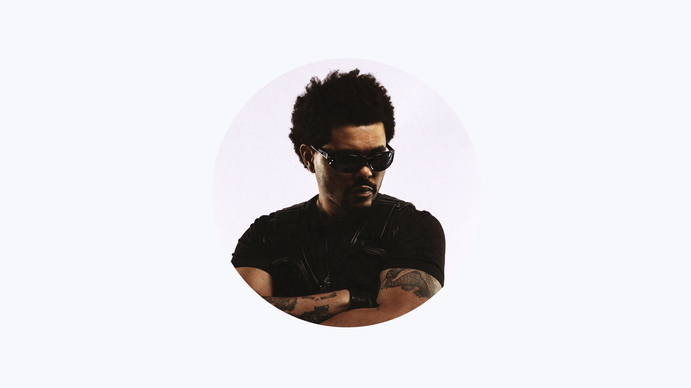
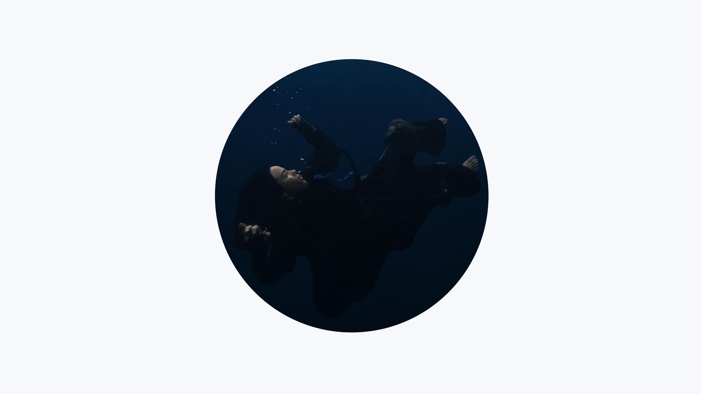
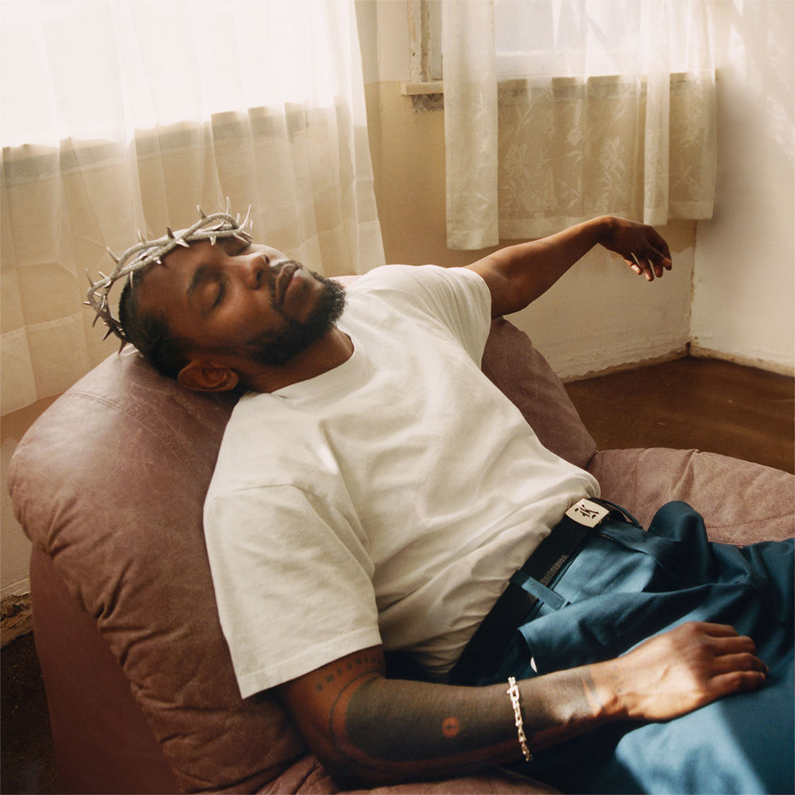
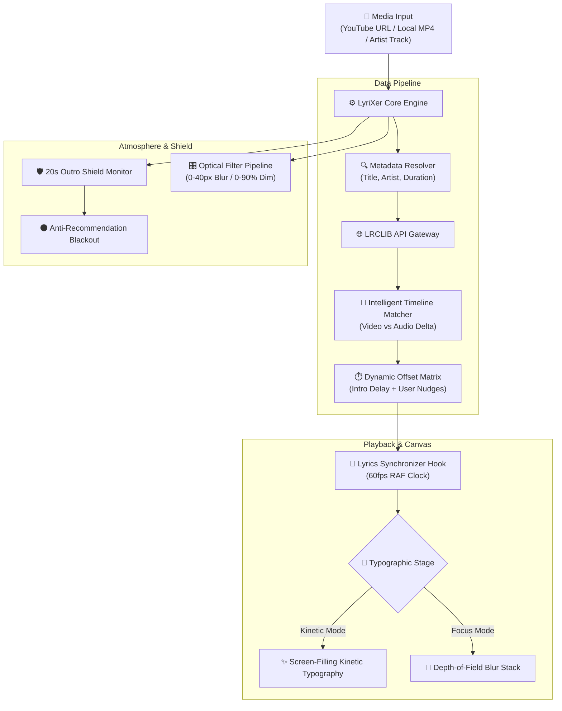

<div align="center">

# ⚡ L Y R I X E R

### *The High-Profile Cinematic Typographic Music Player*

[](https://react.dev/)
[](https://www.typescriptlang.org/)
[](https://vitejs.dev/)
[](https://motion.dev/)
[](https://lrclib.net/)
[](https://opensource.org/licenses/MIT)

<br/>

<p align="center">
  <b>LyriXer transforms standard music videos into an immersive, cinema-grade typographic stage.</b><br/>
  Featuring frame-accurate intro matching, intelligent vocal alignment, depth-of-field lyrical choreography, and an anti-recommendation outro blackout shield.
</p>

```
  ♪   __               _  __             ♪
     / /  __ __ ____  (_)/ /_ ___  ____  
    / /__/ // // __/ / // // // -_)/ __/ 
   /____/\_, //_/   /_//_/ \_,_/\__//_/   
        /___/                            
  ♫   C I N E M A T I C   T Y P O G R A P H Y   ♫
```

[Explore Features](#-key-features) •
[Quick Start](#-quick-start) •
[How It Works](#-architecture--how-it-works) •
[Keyboard Shortcuts](#-keyboard-shortcuts--hud) •
[Design Aesthetic](#-architectural-design-philosophy) •
[Contributing](#-contributing)

</div>

---

## 🌟 The Vision

Music videos often tell stories beyond the recorded audio track: extended theatrical intros, narrative dialogue, skits, and prolonged outros. Traditional lyric players desynchronize instantly the moment an official music video adds a 45-second preamble or cuts to dialogue.

**LyriXer solves this with surgical engineering.** It bridges the gap between raw video footage and structured lyric metadata, rendering responsive, frame-locked anime-grade typography across a responsive atmospheric canvas.

---

## 📸 Visual Tour & Experience

<div align="center">

| 🎬 **Kinetic Cinema Stage** | 🌌 **Focus-Stack Depth Stage** |
|:---:|:---:|
| Ultra-wide, screen-filling anime-inspired dynamic kinetic typography with real-time audio visualization | Depth-of-field focal stack blurring lines dynamically as they approach the vocal focal point |
|  |  |

</div>

<div align="center">

### 🏛️ Curated Artists Discovery Portal & Full Discography

Seamlessly search and launch verified artist discographies with 100vw dynamic hero photography, official music video categories, and instant playback continuity:

| **The Weeknd** | **Juice WRLD** | **Billie Eilish** | **Kendrick Lamar** |
|:---:|:---:|:---:|:---:|
|  |  |  |  |
| *R&B / Synthwave* | *Hip-Hop / Melodic* | *Alternative / Pop* | *Hip-Hop / Conscious* |

</div>

---

## ⚡ Key Features

### 🎯 1. Frame-Accurate Video Intro & Vocal Alignment
- **One-Tap Vocal Sync (`S` Key)**: When the singer utters the first syllable, tap <kbd>S</kbd> or click **"Sync to Vocal Start"** in the bottom HUD. The entire lyric timeline recalibrates instantly to lock onto the vocal entry point.
- **Intelligent LRCLIB Matcher**: Automatically scans LRCLIB candidates, parses song duration against video duration, and predicts intro preambles (e.g., detecting a 97-second music video narrative intro and delaying lyrics precisely).
- **Atomic Nudge Steppers**: Delay or rush lyrics in real-time with sub-millisecond precision:
  - <kbd>[</kbd> **Delay Lyrics** (`+0.1s`, `+0.5s`, `+1.0s` later)
  - <kbd>]</kbd> **Rush Lyrics** (`-0.1s`, `-0.5s`, `-1.0s` earlier)

### 🛡️ 2. Outro Anti-Recommendation Blackout Shield
- YouTube frequently ruins emotional song endings by plastering intrusive recommendation tiles, subscribe bubbles, and external video suggestions over the video during the final 20 seconds.
- LyriXer’s **Recommendation Shield Engine** automatically detects the 20-second outro threshold, gently dissolving into a deep, atmospheric cinema vignette that hides YouTube's clutter while preserving pristine audio and lyric fade-outs.

### 🎭 3. Dual Typographic Display Engines
- **Kinetic Cinema Engine**: Screen-filling bold typography styled after high-end anime title sequences and editorial concert visuals. Includes active instrumental visualizer bars and upcoming lyric teasers.
- **Focus-Stack Depth Engine**: Apple Music / iOS-inspired dynamic depth-of-field stack. Lines blur smoothly as they recede into the distance, with the active line snapping into brilliant focus and scaling forward.
- **Atmospheric Typeface Specimen**: Toggle between **Plus Jakarta Sans**, **Inter Display**, **Classic Editorial Serif**, and **JetBrains Monospace**.

### 🎛️ 4. Optical Atmosphere & Backdrop Physics
- **Precision Blur Control (0px – 40px)**: Defocus intense video backgrounds into smooth ambient light gradients. At `0px`, enjoy the native uncompressed video clarity.
- **Optical Dim Filter (0% – 90%)**: Dial contrast for high-noon brightness or midnight immersion. At `0%`, see 100% of the original video brightness with zero artificial tinting.
- **4 Signature Color Palettes**: *Midnight Violet*, *Neon Cyber*, *Minimalist Slate*, and *Amber Velvet*.

### 🏛️ 5. Artist Hub & Interactive Discography
- **Fuzzy Auto-Complete Search**: Query any artist or genre across an index of curated icons.
- **Filter Tabs**: Rap & Hip-Hop, Pop & Modern, R&B & Soul, Rock & Alternative, and Electronic.
- **Deep Discography Pane**: Browse All Songs, Top Hits (with flame popularity badges), Music Videos, Collabs, and Studio Audios.
- **Floating Continuity Dock**: Keep music running uninterrupted while browsing profiles; resume fullscreen video mode with one click.

---

## ⌨️ Keyboard Shortcuts & HUD

LyriXer is engineered for frictionless hands-on-keyboard control:

| Shortcut | Action | Description |
|:---:|:---|:---|
| <kbd>Space</kbd> | **Play / Pause** | Toggle media playback synchronously |
| <kbd>S</kbd> | **Sync Vocal Start** | Snaps first lyric to current playback position |
| <kbd>[</kbd> | **Delay (+0.1s)** | Nudges lyrics to appear slightly later |
| <kbd>]</kbd> | **Rush (-0.1s)** | Nudges lyrics to appear slightly earlier |
| <kbd>F</kbd> | **Fullscreen** | Toggles true native browser fullscreen |
| <kbd>M</kbd> | **Mute / Unmute** | Toggles audio track mute state |
| <kbd>L</kbd> | **Search LRCLIB** | Opens instant community lyrics search modal |
| <kbd>I</kbd> | **Intro Guide** | Opens widescreen onboarding walkthrough |
| <kbd>Esc</kbd> | **Exit / Return** | Exits player or closes open popovers |

---

## 🏗️ Architecture & How It Works



---

## 📐 Architectural Design Philosophy

LyriXer rejects generic, bubbly consumer design tropes in favor of an **industrial luxury aesthetic** inspired by **Leica, teenage engineering, and Linear**:

- **Sharp Geometric Precision**: Hairline `1px` borders (`rgba(255, 255, 255, 0.08)` to `0.12`), with crisp radii (`2px` for badges, tags, and steppers; `4px` for cards and buttons; `6px` for primary frames).
- **Typography as Architecture**: Display titles set in *Plus Jakarta Sans* with tight negative tracking (`-0.035em`), paired with tabular monospace numerals (*JetBrains Mono*) for zero-jitter timecodes.
- **Glassmorphic Restraint**: Deep obsidian backdrop surfaces (`#08080B`, `#0E0E12`) with calibrated `backdrop-filter: blur(24px)` for legibility over active video scenes without opaque box containers.

---

## 🚀 Quick Start

### Prerequisites
- [Node.js](https://nodejs.org/) (v18.0.0 or higher recommended)
- `npm`, `pnpm`, or `yarn`

### Installation

1. **Clone the repository**:
   ```bash
   git clone https://github.com/Aditya-Vishwakarma722/LyriXer-online-typographic-music-player.git
   cd LyriXer-online-typographic-music-player
   ```

2. **Install dependencies**:
   ```bash
   npm install
   ```

3. **Start the local development server**:
   ```bash
   npm run dev
   ```
   Open `http://localhost:5173` in your browser to experience LyriXer.

4. **Run the automated verification test suite**:
   ```bash
   npm test
   ```
   *Runs tests for timeline matching, end-screen suppression, and atomic offset nudging.*

5. **Build for production**:
   ```bash
   npm run build
   npm run preview
   ```

---

## 📂 Project Structure

```
LyriXer/
├── public/                     # Static media & curated artist photography
│   ├── artists/                # High-resolution artist portraits (Adele, The Weeknd, etc.)
│   ├── favicon.svg             # Precision audio-glyph logo
│   └── hero-bg.jpg             # High-impact atmospheric landing photography
├── src/
│   ├── components/             # Reusable UI primitives (Buttons, Badges, Modals)
│   │   ├── reactbits/          # Spotlight cards, particle effects, kinetic waves
│   │   └── ui/                 # Architectural buttons, badges, modals
│   ├── features/
│   │   ├── artist/             # Artist Hub portal, profiles, discography tracks
│   │   ├── home/               # Hero landing, URL input, recent history, settings
│   │   └── player/             # Fullscreen typographic shell, YouTube host, LRCLIB modal
│   ├── hooks/                  # Synchronizer hooks, keyboard handlers, audio clocks
│   ├── styles/                 # Design tokens (tokens.css), globals, theme overrides
│   └── tests/                  # Verification suites for timing, intro sync & shield
├── package.json                # Project dependencies & build pipelines
└── vite.config.ts              # Vite configuration with React SWC compiler
```

---

## 🛠️ Tech Stack & Ecosystem

<div align="center">

| Layer | Technologies |
|:---|:---|
| **Core Framework** | React 19, TypeScript 5.8, Vite 6 |
| **Animation Engine** | Framer Motion (Motion v14) |
| **Typography & Icons** | Plus Jakarta Sans, Inter, JetBrains Mono, Lucide Icons |
| **Lyrics Provider** | [LRCLIB](https://lrclib.net/) Community Synced Lyrics API |
| **Styling & Tokens** | Pure CSS Variables, Architectural Hairline Borders, Responsive CSS Grid |
| **Code Quality** | Oxlint, TypeScript strict type checking |

</div>

---

## 🤝 Contributing

Contributions make the open-source community an incredible space to learn, create, and inspire. Any contributions you make are **greatly appreciated**.

1. Fork the Project
2. Create your Feature Branch (`git checkout -b feature/EpicLyricFeature`)
3. Commit your Changes (`git commit -m 'feat: Add epic lyric feature'`)
4. Push to the Branch (`git push origin feature/EpicLyricFeature`)
5. Open a Pull Request

---

## 📜 License

Distributed under the **MIT License**. See `LICENSE` for more information.

---

<div align="center">

### Crafted with passion for music, design & typography.

*Experience music the way artists intended.*

[Back to top ↑](#-lyrixer)

</div>
